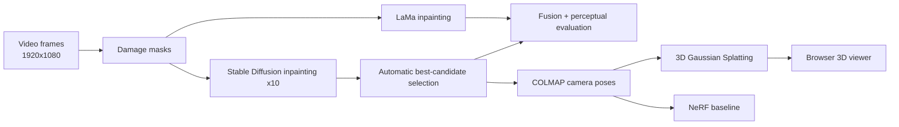

# Artefact Restoration 3D

Digitally restore a damaged ceramic artefact from video frames and rebuild it as a 3D model that can be viewed in a browser — using only free tools and a free Google Colab GPU.

This project reproduces the pipeline of **Stoean et al. (2024), *Artificial Intelligence-Driven 3D Restoration of Degraded Artefacts*, Journal of Cultural Heritage 69:18–26** and extends it with my own contributions. The goal is a working, publicly viewable demo, not just numbers.

> **Status: work in progress.** Stage 0 (repo, setup, dataset inventory) is done. Stages are ticked off below as they are completed and verified; nothing here is claimed before it has been run.

## Pipeline



## Roadmap

| Stage | What | Status |
|---|---|---|
| 0 | Repo skeleton, Colab setup, dataset download + inventory | ✅ code ready (run on Colab to confirm dataset layout) |
| 0b | Ground-truth set: 29 undamaged frames (Images minus masks), pot located with Segment Anything, the paper's 4 test-mask types | ✅ code ready, tested on mock data (run notebook 02 on Colab and check the preview sheets) |
| 1 | LaMa inpainting | ⬜ |
| 2 | Stable Diffusion inpainting ×10 (resumable) | ⬜ |
| 3 | Automatic candidate selection (CLIP-IQA / MUSIQ / TOPIQ + multi-view consistency) | ⬜ |
| 4 | Perceptual evaluation + LaMa↔SD fusion | ⬜ |
| 5 | Damage masks: SAM vs. supervised U-Net | ⬜ |
| 6 | COLMAP → 3D Gaussian Splatting (held-out views) + NeRF baseline | ⬜ |
| 7 | Web app: before/after sliders + interactive 3D viewer | ⬜ |

Stretch goals: historical-reference guidance (IP-Adapter), 2D Gaussian Splatting mesh export, BrushNet comparison, ablation over image counts.

## Run it on free Colab

1. Open `notebooks/00_setup_colab.ipynb` in Colab, pick **Runtime ▸ T4 GPU**, run all.
2. Open `notebooks/01_dataset_inventory.ipynb`, run all (downloads ~700 MB, resumable).
3. Notebooks run in order; each writes to Google Drive and skips work already done, so a disconnected session can simply be re-run.

Local checks (no GPU needed):

```bash
pip install -r requirements-dev.txt
python -m pytest -q
```

## Dataset facts (verified from the real archive)

The archive ships only `Images/` (334 frames, 1920×1080) and `masks/` (305 annotated masks). There is no ground-truth folder: the paper's **29 ground-truth frames are the frames with no mask** (damage not visible), so `scripts/prepare_gt.py` derives them as `Images` minus `masks`, locates the pot with Segment Anything, then builds the paper's four test masks (rectangle, marginal, large-marginal, multiple) on it with a fixed seed. Note: the 305 shipped masks mark only the missing rim part, not the whole pot.

## Repository layout

```
configs/default.yaml     all settings in one place (seed, SD runs, 3DGS iterations, paths)
src/heritage/            shared code: paths, frame-ID matching, Colab helpers, inventory, GT split, mask generator
scripts/                 command-line tools (dataset download, ground-truth + test-mask builder)
notebooks/               one notebook per stage, designed for free Colab
tests/                   unit tests (frame matching, inventory, download resume)
web/                     portfolio web app (later stage)
assets/samples/          small curated before/after images for this README and the web app
```

## Engineering notes (lessons carried over from the first implementation)

- **Frame IDs:** ground-truth frames start at `frame_00084` while other folders start at `frame_00001`, and each stage decorates file names differently (`_mask001`, `_mean`, `_sd_run03`). One tested function (`heritage.ids`) does all matching.
- **Resumable everything:** free Colab disconnects; every long job writes to Drive as it goes.
- **NumPy/PyTorch:** the old DGX environment needed `numpy<2`. The setup notebook runs a real numpy↔torch conversion test and only pins if it fails.
- **COLMAP → 3DGS:** COLMAP's `SIMPLE_RADIAL` cameras must be undistorted to `PINHOLE` before 3D Gaussian Splatting accepts them; only the ~305 of 334 registered frames can be used.
- **Resolution policy:** Stable Diffusion works at 512×512 while frames are 1080p, so outputs are resized with one explicit policy before any comparison.

## Data, license and citation

- Dataset: *Degraded Artefact Image Data Set*, Figshare, doi:10.6084/m9.figshare.24637428 — licensed **CC BY 4.0**. Images come from a video of an artefact at the Oltenia Museum's Restoration and Conservation Laboratory, Craiova, Romania. The dataset and model weights are not stored in this repository; scripts download them.
- Paper: C. Stoean, R. Stoean, A. Ciobanu, N. Bacanin, L. Ionescu, *Artificial Intelligence-Driven 3D Restoration of Degraded Artefacts*, J. Cultural Heritage 69 (2024) 18–26, doi:10.1016/j.culher.2024.07.008.
- Code: MIT License (see `LICENSE`). Third-party models keep their own licenses.

Author: Abhishek Raveendran — M.Sc. AI & ML, Mahatma Gandhi University, Kottayam.
